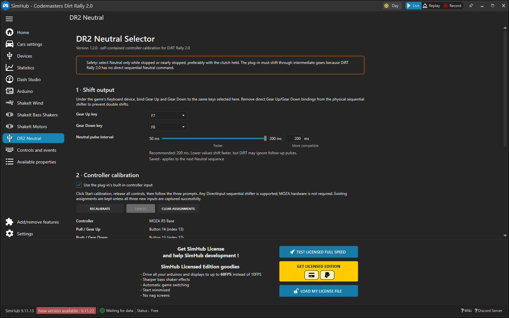

# DR2 Neutral Selector for SimHub

[](https://github.com/eugeny-dementev/simhub-dr2-neutral/actions/workflows/ci.yml)
[](https://github.com/eugeny-dementev/simhub-dr2-neutral/releases/latest)
[](LICENSE)

DR2 Neutral Selector adds a telemetry-confirmed Neutral command for sequential
shifters in DiRT Rally 2.0. Calibration lives in the plugin's SimHub settings
page, so players do not need scripts, compiler tools, JoystickPlugin
expressions, or Keyboard Emulator mappings.

```text
Lever pull       -> one Gear Up key pulse
Lever push       -> one Gear Down key pulse
Reverse trigger  -> Select Neutral

6/5/4/3/2/1 -> confirmed Gear Down pulses -> N
R           -> one confirmed Gear Up pulse -> N
N           -> no key pulse
```

> [!WARNING]
> Neutral selection passes through real gears. Use it only while stationary or
> nearly stationary, preferably with the clutch held.



## Why this plugin

- Guided three-movement DirectInput calibration inside SimHub.
- Supports any compatible sequential shifter with three distinct buttons.
- Fresh telemetry is required and every intermediate shift is confirmed.
- Neutral pulse spacing is configurable from 50–200 ms. The compatibility-first
  200 ms default prevents rapid follow-up shifts when telemetry updates quickly.
- Keyboard output is restricted to the foreground DiRT Rally 2.0 process.
- Neutral operations are serialized, cancellable, timeout-bounded, and capped.
- Structured UTC event logs correlate every input, decision, pulse, and result.
- One-click, rollback-capable install and recoverable uninstall.
- Stable SimHub actions and diagnostic properties for advanced profiles.

## Requirements

- Windows 10 or later with SimHub installed.
- DiRT Rally 2.0 telemetry configured in SimHub.
- Gear Up and Gear Down bound under the game's **Keyboard** device. Defaults are
  F7 and F8; F1-F12 can be selected in the plugin.
- Direct game bindings removed from the sequential lever and reverse trigger,
  otherwise one movement can cause two shifts.
- SimHub and DiRT Rally 2.0 running at the same Windows privilege level.

Version 1.2.0 was runtime-tested with SimHub 9.11.13 and is built in CI against
the pinned official SimHub 9.11.22 release. The ready-made package needs no .NET
SDK or development tools.

## Install and calibrate

1. Download `DR2Neutral-<version>-SimHub.zip` and `SHA256SUMS.txt` from the
   [latest release](https://github.com/eugeny-dementev/simhub-dr2-neutral/releases/latest).
2. Extract the entire ZIP to a normal folder and double-click `Install.cmd`.
3. Approve the Windows administrator prompt if the SimHub installation folder
   requires it. The installer restarts SimHub and verifies plugin startup.
4. Open **DR2 Neutral** in SimHub, confirm the Gear Up/Gear Down keys and the
   recommended 200 ms Neutral pulse interval, then click **Start calibration**.
5. Release all inputs, then follow the prompts to pull the lever, push the
   lever, and pull the reverse/neutral trigger.

All three controls must be distinct buttons on one device. Simultaneous presses,
held startup inputs, duplicates, disconnects, and timeouts are rejected. Old
assignments remain active unless the complete new calibration saves successfully.

### Tune Neutral pulse timing

Keep **200 ms** for the most compatible behavior. To experiment, use the slider
for 5 ms steps or type any whole number from 50 through 200. A valid change is
saved on slider release, keyboard adjustment, Enter, or when the manual field
loses focus. It applies to the next Neutral sequence; a running sequence keeps
the interval it captured when queued. Lower values are faster, but DiRT may
ignore a follow-up pulse and the plugin will safely stop on telemetry timeout.

See the full [installation and recovery guide](docs/INSTALLATION.md) and
[troubleshooting guide](docs/TROUBLESHOOTING.md).

## First safe test

While stationary with the clutch held:

1. Focus DiRT Rally 2.0 and confirm pull/push each shift exactly once.
2. From fourth gear, trigger Neutral and confirm `4 -> 3 -> 2 -> 1 -> N`.
3. From Reverse, trigger Neutral and confirm `R -> N`.
4. From Neutral, trigger again and confirm no shift occurs.
5. Check **Last result**, **Current gear**, **Neutral ready**, and telemetry age
   on the plugin page.

## Public SimHub interface

Advanced users can map these stable names in SimHub profiles. Do not map the
same physical controls while built-in input is enabled.

| Kind | Name |
| --- | --- |
| Action | `DR2Neutral.GearUp` |
| Action | `DR2Neutral.GearDown` |
| Action | `DR2Neutral.SelectNeutral` |
| Property | `DR2Neutral.CurrentGear` |
| Property | `DR2Neutral.GameName` |
| Property | `DR2Neutral.Busy` |
| Property | `DR2Neutral.Ready` |
| Property | `DR2Neutral.TelemetryAgeMs` |
| Property | `DR2Neutral.LastResult` |
| Property | `DR2Neutral.InputStatus` |
| Property | `DR2Neutral.ControllerConnected` |
| Property | `DR2Neutral.Calibrated` |
| Property | `DR2Neutral.ControllerName` |
| Property | `DR2Neutral.CalibrationActive` |
| Property | `DR2Neutral.CalibrationStatus` |
| Property | `DR2Neutral.NeutralPulseIntervalMs` |

## Diagnostic event log

SimHub writes plugin events to `SimHub\Logs\SimHub.txt`. Search for
`[DR2Neutral.Event]`; the remainder of each matching line is a bounded JSON
object with an ISO-8601 UTC `timestampUtc`, an `event`, and—when an input starts
an operation—an `operationId` that ties the complete sequence together.

The log records mapped button rising edges, every safety-condition result,
key-down/key-up injection, telemetry-confirmed gear changes, timeouts,
rejections, cancellations, failures, and completion. It deliberately does not
log every 10 ms telemetry poll or slider preview, so diagnostics cannot flood
the hot loop. Queue, start, interval-wait, and completion events contain the
captured `neutralPulseIntervalMs`. See
the [troubleshooting guide](docs/TROUBLESHOOTING.md#collect-a-structured-event-trace)
for a copy-and-paste trace command.

## Build and contribute

Development requires Windows, the .NET SDK selected by `global.json`, and
SimHub. The newer SDK is only the build tool; the plugin targets .NET Framework
4.8/x86 because it loads in SimHub.

```powershell
.\test.ps1
.\package.ps1
```

Start with [CONTRIBUTING.md](CONTRIBUTING.md), then see the
[development guide](docs/DEVELOPMENT.md), [architecture](docs/ARCHITECTURE.md),
and [release process](docs/RELEASING.md).

## Project status and support

This is an independent community project, not affiliated with or endorsed by
SimHub, Codemasters, Electronic Arts, or MOZA Racing. Product and company names
are trademarks of their respective owners. Read [SUPPORT.md](SUPPORT.md) before
opening an issue and report security problems through [SECURITY.md](SECURITY.md).

Released under the [MIT License](LICENSE).
