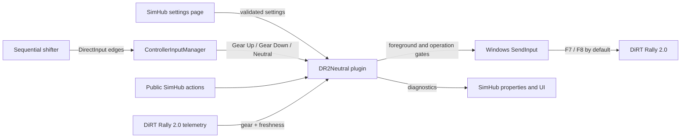

# Architecture

DR2 Neutral Selector is a single x86 .NET Framework 4.8 assembly loaded by
SimHub. SimHub supplies telemetry, lifecycle, settings persistence, logging, and
the public action/property host. SharpDX DirectInput reads the calibrated device;
Windows `SendInput` emits the configured F-keys.

## Components

- `DR2NeutralPlugin.cs` owns SimHub lifecycle, public names, telemetry state,
  operation serialization, focus checks, bounded key pulses, and diagnostics.
- `ControllerInputManager.cs` owns one lifecycle-bound polling loop, device
  reconnects, edge detection, and transactional three-step calibration.
- `DR2NeutralSettings.cs` owns defaults, cloning, bounds, and validation.
- `DR2NeutralSettingsControl.cs` builds the WPF settings/calibration page.
- `install.ps1` and `uninstall.ps1` own bounded, backup-first SimHub mutations.

## Safety invariants

- No keyboard event is sent unless the foreground process/window identifies
  DiRT Rally 2.0; focus is checked immediately before each key-down.
- Neutral requires running DiRT Rally 2.0 telemetry no more than 1500 ms old and
  a known gear.
- A key is held for 35 ms and released in a `finally` path.
- Each shift waits at most 1000 ms for a confirmed gear change.
- Neutral pulse spacing is bounded to 50–200 ms, defaults and migrates to
  200 ms, and is captured once per queued operation.
- A Neutral sequence emits no more than 10 pulses.
- Calibration, single shifts, and Neutral sequences cannot overlap improperly.
- Settings are committed only after a complete valid calibration.
- Shutdown cancels work and all waits remain bounded.

## Compatibility boundary

Only documented SimHub plugin interfaces and assemblies from the installed
SimHub distribution are referenced. The project does not redistribute them.
The public `DR2Neutral.*` names are treated as a stable compatibility surface.
`DR2Neutral.NeutralPulseIntervalMs` exposes the persisted global interval in
milliseconds; it is diagnostic and read-only from SimHub profiles.
